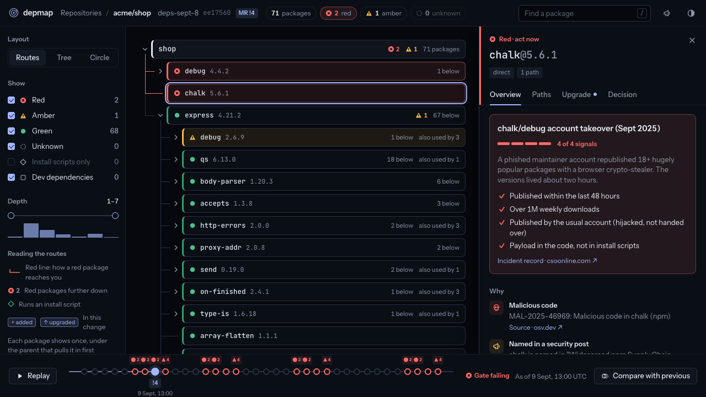
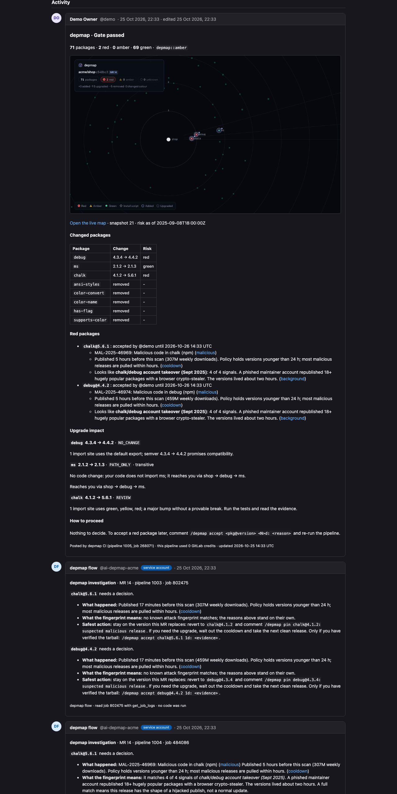
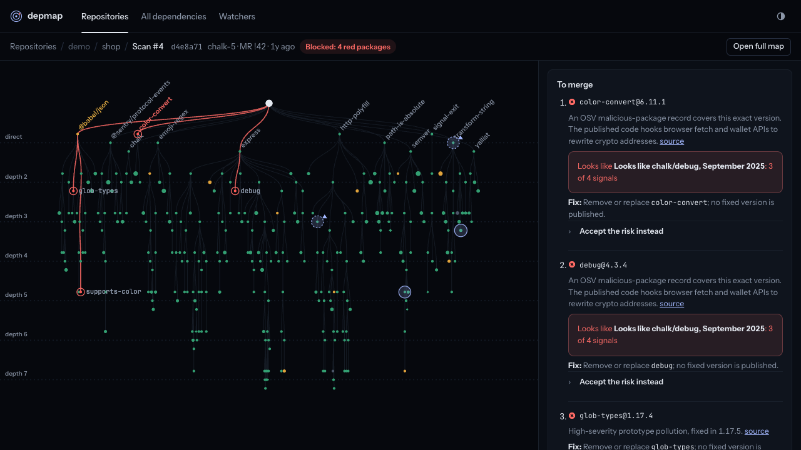
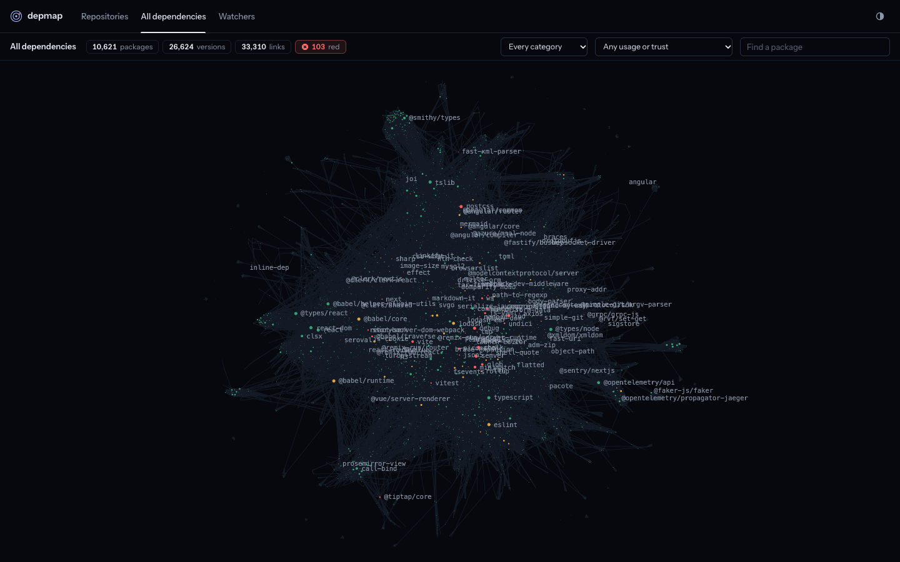

# depmap: a dependency map and merge gate for npm supply-chain attacks

depmap scans every npm dependency of every commit, blocks merge requests that pull in a suspicious version, shows which lines of your code it touches, and lets a GitLab Duo flow open the fix. It catches malicious releases from how they behave, so it can block them before any advisory exists.

Built for the GitLab Life After Code hackathon. Path A, supervised autonomy, all nine DevSecOps stages, MIT licensed.

## Quick links

| | |
|---|---|
| Live app | https://lac.adtomic.co (sign in as `judge`; the password is in the submission form) |
| Code | https://gitlab.com/gitlab-ai-hackathon/transcend-october-2026/5037040/depmap |
| Demo video | *(YouTube link)* |
| Duo flow | `flows/depmap.flow.yml`, started by a failed pipeline or by mentioning the flow's account in an MR |
| CI include | `https://lac.adtomic.co/ci/templates/depmap.gitlab-ci.yml` |



## The problem

On 8 September 2025 someone phished an npm maintainer and republished chalk, debug and 16 other packages with a crypto-stealer inside. Together they get over 2 billion downloads a week. The bad versions were up for about two hours.

Seventeen minutes after they went out, at 13:30 UTC, no scanner had heard of them. OSV published its malicious-package records at 14:26 and 17:11, and the write-ups came the next day. A team that merged a routine dependency bump in that window shipped the payload, and a CVE-based check would have passed it. Shai-Hulud did the same thing a few weeks later.

Advisory scanners can't see these attacks in the first hours, because there's nothing to look up yet. And when they do fire, they tell you a package is bad but not where your code uses it or what to change.

## How it works

```
push / MR ──CI──> depmap:scan ──> depmap server
                    lockfile -> full dependency graph -> registry facts
                    -> OSV and malware feeds -> security watchers
                    -> behaviour rules -> attack fingerprints
                    -> upgrade advisor (which lines of your code break)
                         |
                  depmap:gate  -- undecided red package? --> pipeline fails
                         |                                       |
                  depmap:report                        Duo flow: reader -> triage
                  one MR note, edited in place          -> investigator (explains)
                  (map, red packages, evidence,         -> fixer (commit + fix MR)
                   where your code uses them, fix)               |
                         |                               a person reviews and merges
          /depmap accept chalk@5.6.1 7d: reason
                         |
schedule ──> depmap:refresh: a new advisory re-colours that version
             in every repo and opens an issue in each one
```

The CI template sends the lockfile (npm or pnpm, workspaces included) and your JS/TS sources to the depmap server. The server builds the full dependency graph and gives each `package@version` a colour. It goes red for a malicious-package record, a critical advisory, a release younger than the cooldown, a likely typosquat, an install script that wasn't there before, or a publisher change where provenance was dropped. Red packages are also compared with fingerprints of real attacks (chalk/debug 2025, Shai-Hulud 2025, ua-parser-js 2021, event-stream 2018), so the note can say "looks like the chalk/debug takeover, 4 of 4 signals".

For every version bump, the upgrade advisor works out whether your code has to change. It finds your import and call sites with oxc, and compares the old and new tarballs' type definitions and module formats with the TypeScript compiler. For chalk 4 to 5 it reports `src/log.js:1`: chalk 5 is ESM-only, so `require('chalk')` throws `ERR_REQUIRE_ESM`. For a transitive bump it says the package reaches you through `shop -> debug -> ms` and needs no code change.

`depmap:gate` fails the pipeline while a red package is undecided. `depmap:report` posts a single MR note and keeps editing it rather than adding new ones. A person clears a package with `/depmap accept chalk@5.6.1 7d: reason` or `/depmap pin`. We store who decided, why and until when, and once the expiry passes the gate blocks again.

Nothing has to be committed for the colours to change. A scheduled pipeline polls seven security sources (GitHub malware advisories, Aikido, StepSecurity, Wiz, Snyk, OpenSSF and CISA) and re-checks every branch. Risk belongs to the `package@version`, so one new advisory turns the same version red in every repo and opens a `security::watch` issue in each.


*From our end-to-end run against the local GitLab stand-in: the CI note, then the flow's investigation.*

## The Duo flow

`flows/depmap.flow.yml` is a flow registry v1 flow with four agents. Everything deterministic happens in CI and costs no credits; the agents only run when something is red.

| Agent | Tools | Job |
|---|---|---|
| reader | `get_merge_request`, `gitlab_api_get`, `get_job_logs` | finds the MR's scan job and reads its receipt, or stops if there's nothing to do |
| triage | `get_merge_request` | decides whether the request is "explain" or "fix" |
| investigator | `create_merge_request_note` | explains each red package: what happened, what the fingerprint means, the safest action |
| fixer | `get_repository_file`, `create_commit`, `create_merge_request`, `create_merge_request_note` | edits `package.json` and any code that has to change, commits to `depmap/fix-<pkg>`, opens the MR |

The flow starts when the pipeline fails, or when someone mentions its account in the MR (`@<flow account> fix chalk`). Where triggers aren't available, `depmap:report` starts it through `POST /api/v4/ai/duo_workflows/workflows`. On fix branches, `depmap:relock` regenerates the lockfile without running install scripts, and the new pipeline scans the result. A person still reviews and merges the fix MR.

The flow never installs or runs package code; the scan already has everything it needs. `flows/simulate.ts` checks the YAML and walks the flow against a mock GitLab in our tests.

When a fix crosses a breaking version, a background job asks Claude Haiku 5.5 for the code change (`server/src/advisor/aifix.ts`). It reads the package's own migration notes and returns exact line edits, and we check that every edit matches the file before showing it. On our test app that was 2 of the 17 red packages; the other 15 needed no code change.

## Every push gets a page



The `depmap` commit status links to `/repos/<group>/<project>/scans/<scan>`. The left side shows the tree upside down with your repo at the top and the paths to red packages in red. The right side lists what to do before merging: the version to move to (or stay on), the accept command, and every line of your code that has to change.

## All dependencies



The All dependencies page is one map of every package we have scanned, across all repos. Each node is a package, with all its versions folded together and sized by how many other packages depend on it. Click one to see each version's publish date, publisher, provenance and advisories. For each advisory it shows the affected range, the fixed version (or the newest clean one if there's no fix), the fix commit, and the vulnerable code from the advisory itself.

Packages are also labelled by what they do, how they're used (runtime or dev only, direct, install script) and how far to trust them. One maintainer and no provenance are labels; so is load-bearing, which means ten or more dependents and a single maintainer. The filters make questions like "runtime HTTP packages with one maintainer" a click. `scripts/crawl.ts` keeps the map growing by following packages back to their own repos' lockfiles. The hosted instance has about 10,900 packages and 29,000 versions.

## Replaying 8 September 2025

We replayed the attack against only what was public at each point in time:

| As of (UTC) | What was public | Gate |
|---|---|---|
| 13:30 | chalk@5.6.1 and debug@4.4.2, 17 minutes old, no advisory | blocked by the cooldown rule and the takeover pattern |
| 18:00 | the OSV `MAL-` records | blocked, fingerprint 4 of 4 |
| 9 Sept, 13:00 | Wiz's write-up, picked up by the watchers | blocked, with the post linked |

Advisories are filtered by publish date, a version that was unpublished later still counts in a past replay, and feeds that only give a date count as end of day. One side note: when we built depmap's own container, pnpm's release-age setting refused the same two fresh packages our cooldown rule had flagged in our lockfile.

## Lifecycle stages and prizes

All nine stages are covered, with a file or page for each in `docs/STAGES.md`:
- plan: issues from the scheduled refresh;
- create: fix MRs;
- verify: the gate;
- package: a CycloneDX SBOM and the container image;
- secure: rules, feeds and fingerprints;
- release: the tag pipeline and GitLab Release;
- configure: `.depmap.yml` behind CODEOWNERS;
- monitor: the refresh, the watchers and commit statuses;
- govern: decisions with an expiry, plus an audit log.

We're entering Path A Supervised (the agents investigate and open fixes; people merge or accept the risk), Most Stages Covered, Most Environmentally Impactful and Most Creative. For the Google Cloud bonus there's `deploy/cloudrun-deploy.sh` (Cloud Run and Cloud SQL in `europe-north1`); the live instance itself runs on EC2.

## Sustainability

Each scan records its Software Carbon Intensity. Energy comes from Cloud Carbon Footprint coefficients applied to the CPU, memory and bytes we measure; grid intensity is location-based; embodied emissions are left out, and the receipt says so.

| Run | Time | Network | gCO₂e |
|---|---|---|---|
| 428-package Next.js app, first scan | 29.3 s | 573 requests, 386 MB | 0.231 |
| same app, next scan | 47 ms | none | ~0 |

The second scan is almost free because registry facts never change for a given `package@version`. We fetch them once and share them across repos, and we key graphs by lockfile hash. A new advisory triggers a re-check, not a re-download. Running in `europe-north1` (30 g/kWh) instead of `us-east1` (579 g/kWh) cuts grid intensity by about 95%. Details are in `docs/SUSTAINABILITY.md`.

## Built with

- Rust compiled to WebAssembly for the graph core (layout, paths to root, diff); it lays out 50k nodes in about 7 ms and caches the layout in IndexedDB.
- Vite, TypeScript, sigma.js and graphology for the maps, with ForceAtlas2 for the All dependencies view.
- Node 26, Hono and PostgreSQL 17 on the server.
- oxc-parser and the TypeScript compiler API for the upgrade advisor.
- Data from the npm registry, OSV.dev, GitHub malware advisories, seven security sources and e18e's `module-replacements`.
- On GitLab: a Duo Agent Platform flow, a CI/CD template, MR notes, labels, commit statuses, issues, schedules, CycloneDX reports, Releases, the Container Registry and OAuth.
- Claude Haiku 5.5 for code fixes across breaking versions.

```
crates/graph-core/     Rust/WASM graph core (docs/CONTRACT.md)
server/src/scanner/    lockfiles, registry facts, OSV, rules, fingerprints, refresh, SCI, classification
server/src/advisor/    upgrade advisor and the Claude fixer
server/src/watchers/   the seven security sources
server/src/connector/  GitLab connector (PAT or OAuth with PKCE; tokens encrypted with AES-256-GCM)
server/src/gitlab/     local GitLab stand-in used by the tests
web/                   the UI
ci/                    CI scripts and the includeable template
flows/                 the Duo flow and its simulator
scripts/               demo, seeding, local scans, crawler, local GitLab, Pages export, test runner
deploy/                Dockerfile, EC2 compose and deploy script, Cloud Run script
```

## Running it

The quickest way is the hosted app: https://lac.adtomic.co, signed in as `judge`.

To run it locally and offline, `scripts/demo.sh` starts Postgres, loads the 8 September timeline and serves the app on :8787 and a local GitLab on :8929/view. Step by step:

```
pnpm install
pnpm db:up                                   # Postgres 17 in Docker on :5433
pnpm build:wasm && pnpm build:web
DATA_MODE=replay ADVISORY_FEED=fixtures/feed/simulated-advisory.json node scripts/seed-demo.ts --reset
DATA_MODE=replay node server/src/api/main.ts # app on http://localhost:8787
node server/src/gitlab/mock.ts               # local GitLab on http://localhost:8929
```

`DATA_MODE=replay` uses only the recorded public data in `fixtures/`, `record` fetches whatever is missing, and `live` always fetches. To scan a project on disk, run `node scripts/scan-local.ts ../my-app`. To grow the All dependencies map, run `node scripts/crawl.ts` (Ctrl-C stops it and it resumes from its queue). To export the GitLab Pages security site, run `node scripts/export-pages.ts public`.

To use it on your own project, add the template:

```yaml
include:
  - remote: https://lac.adtomic.co/ci/templates/depmap.gitlab-ci.yml
```

Set `DEPMAP_API_URL`, and the masked `DEPMAP_TOKEN` and `GITLAB_TOKEN` variables. Then create the flow from `flows/depmap.flow.yml` under AI > Flows and add its triggers. `docs/GITLAB.md` walks through every step.

## Policy

A `.depmap.yml` at the root of a repo changes the rules for that repo:

```yaml
cooldown_hours: 48          # red while younger than this, amber up to 3x (default 24)
block_on: [red, amber]      # colours that fail the gate (default [red])
allow:                      # standing decisions: name@semver-range and a reason
  - pkg: debug@~4.4.0
    reason: pinned by the logging team
licenses:
  deny: [AGPL-3.0]
```

The scan sends the file along, so the gate, the UI and the scheduled refresh all apply the same policy. An unknown key fails the scan. The gate log says which rule blocked each package, e.g. `x chalk@5.6.1  [policy: block_on: red · cooldown_hours: 48]`. CODEOWNERS protects the file and `ci/`.

## Tests

`pnpm test:all` runs everything and writes `test-results/summary.json`:
- 42 server tests (vitest, on a separate test database);
- 11 Rust tests;
- 16 Playwright tests, against mock data and the live API;
- 22 checks across the GitLab MR scenarios run under gitlab-ci-local.

`pnpm test:gitlab-real` starts GitLab CE 19.5 and a runner in Docker. It pushes the demo repos, which pull in the template exactly as any project would, and runs real pipelines: main, three MRs (chalk 5, a debug patch, the 8 September replay), an accept, a re-run and a scheduled refresh. It then checks the notes, labels, uploads, commit statuses and issues.

Pushing a `v*` tag runs the release pipeline. It runs the tests, pushes the image to the Container Registry, checks depmap's own lockfile with depmap, and creates a GitLab Release with a changelog and the SBOM attached.

## Hosting

https://lac.adtomic.co runs on a single EC2 host: Caddy for TLS in front of the depmap container and Postgres (`deploy/compose.prod.yml`). Redeploy with `deploy/ec2-deploy.sh`. With `REQUIRE_LOGIN=1`, every API call needs a depmap account or a GitLab sign-in (OAuth with PKCE, scope `read_api`), and CI jobs use the masked `DEPMAP_TOKEN`. Scans of private repos stay on the machine that made them; `.dockerignore` keeps `fixtures/local` out of the image.

## License

MIT, see `LICENSE`.
